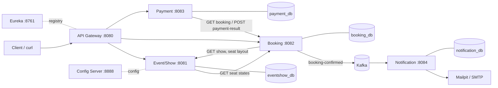
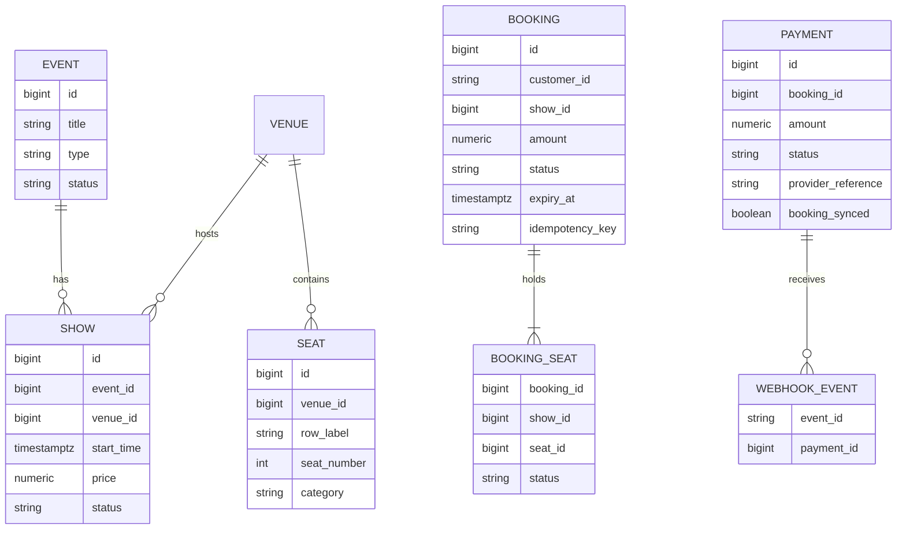
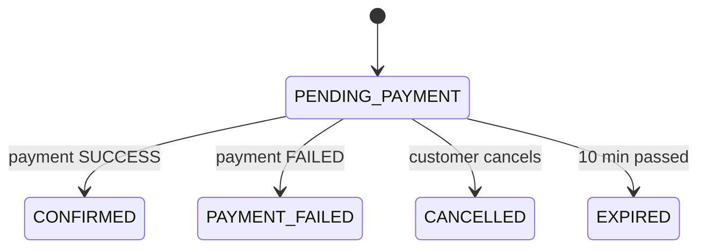
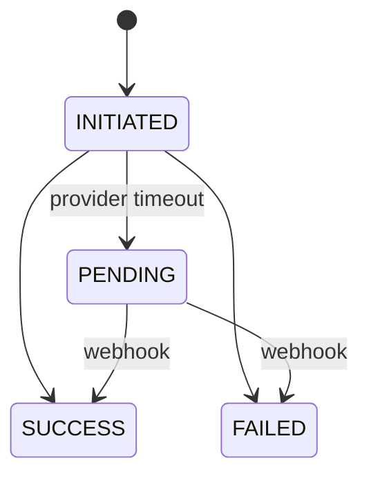
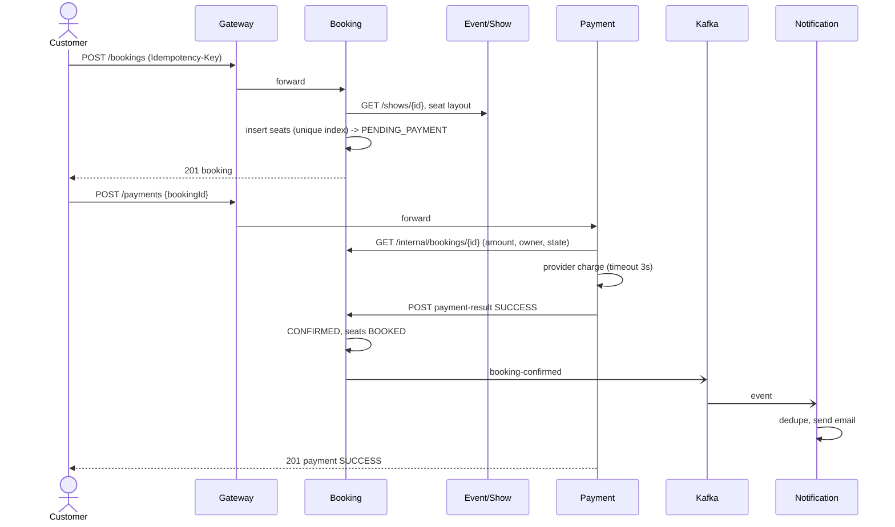

# TicketHub — Architecture (HLD, LLD, UML)

## 1. High-level design

Why this shape: **database per service** (no service reads another's tables), **synchronous REST** where the caller needs the
answer now (Booking needs the show; Payment needs the booking amount), **Kafka** where the caller must not wait or care
(confirmation email). The Gateway is the only public entry; `/internal/**` is not routed.

## 2. Services and responsibilities
| Service | Owns | Key endpoints |
|---|---|---|
| Event/Show | events, venues, seats, shows | `/events`, `/venues`, `/shows`, `/shows/{id}/seats`, `/internal/shows/{id}/seat-layout` |
| Booking | bookings, seat holds | `POST /bookings`, `GET /bookings/{id}`, `POST /bookings/{id}/cancel`, `/internal/...` |
| Payment | payments, webhook events | `POST /payments`, `GET /payments/{id}`, `POST /payments/webhook` |
| Notification | notifications | Kafka listener, `GET /internal/notifications?bookingId=` |

## 3. Entities (ER)

Cross-service references (booking.show_id, payment.booking_id) are plain ids, **not** foreign keys: that is what "database per service" means.

## 4. State machines

Event: DRAFT → PUBLISHED → CANCELLED. Show: SCHEDULED → OPEN → CLOSED/CANCELLED. Final states never change.

## 5. Main flow (sequence)

## 6. The hard problems and how they are solved
| Problem | Solution | Proof |
|---|---|---|
| Two customers, same seat | Partial unique index `(show_id, seat_id) WHERE status IN (RESERVED,BOOKED)`; loser gets 409 `SEAT_UNAVAILABLE` | SQL test + `BookingFlowIntegrationTest` (8 threads) |
| Client retries create booking | `Idempotency-Key` + request fingerprint: same → same booking (200); different body → 409 | integration test |
| Unpaid bookings hold seats forever | `expiry_at` + scheduler sets EXPIRED and releases seats; late payment → 409 `BOOKING_EXPIRED` | integration test |
| Double charge | `UNIQUE(booking_id)` on payments; race handled | `concurrentPayRequests...` test |
| Provider slow / unknown outcome | hard timeout → PENDING + 504; webhook resolves it | `providerTimeout...` test |
| Fake webhook | HMAC-SHA256 of the raw body, constant-time compare | webhook tests |
| Webhook replay / late conflict | `webhook_events` primary key; final payments never change | webhook tests |
| Booking down when payment ends | `booking_synced=false`, scheduler retries | `ifBookingIsDown...` test |
| Duplicate Kafka delivery | notification `UNIQUE(event_id)` | `...DeliveredTwice...` test |
| Email fails | notification FAILED, booking stays CONFIRMED | `aFailingEmail...` test |

## 7. Error contract
Every error: `{timestamp, status, error, code, message, path, details[]}`. Codes are stable (e.g. `SEAT_UNAVAILABLE`,
`BOOKING_EXPIRED`, `IDEMPOTENCY_KEY_REUSED`, `INVALID_SIGNATURE`); the gateway returns the same shape for 404/502/503/504.

## 8. Still to do (not in this zip)
Keycloak/JWT security, Resilience4j circuit breaker/retry, observability stack, S3 poster upload, outbox for guaranteed
event delivery (Phase 2), real provider sandbox. Today customer identity is the `X-Customer-Id` header and the booking API
trusts it — **do not expose this build to the internet**.
